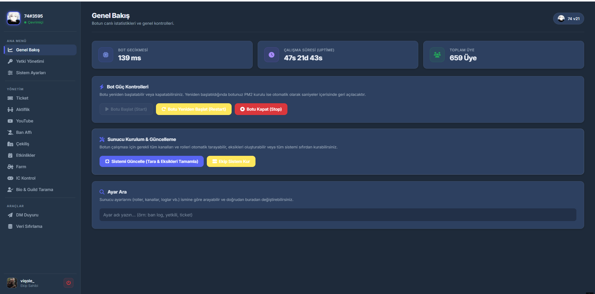
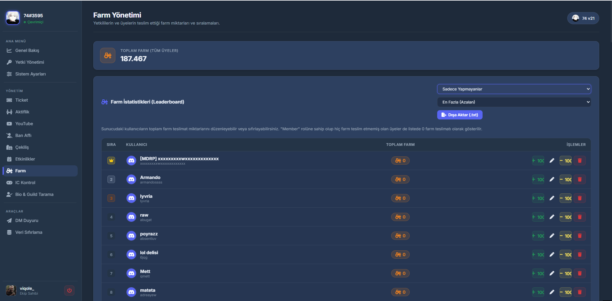
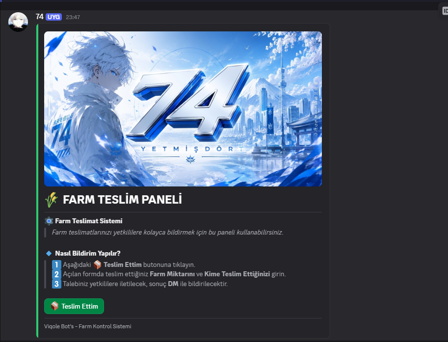
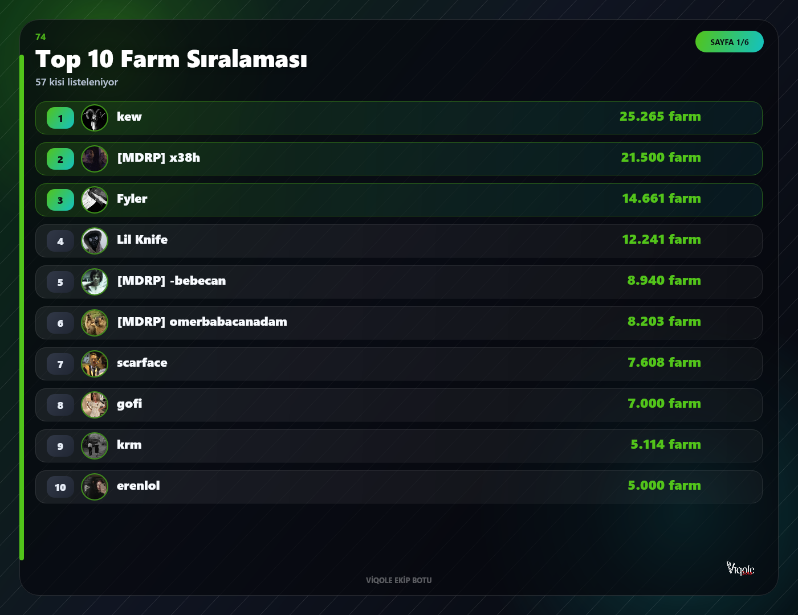
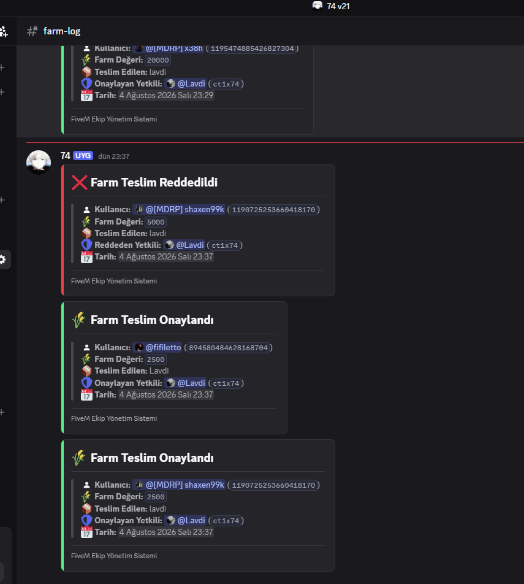
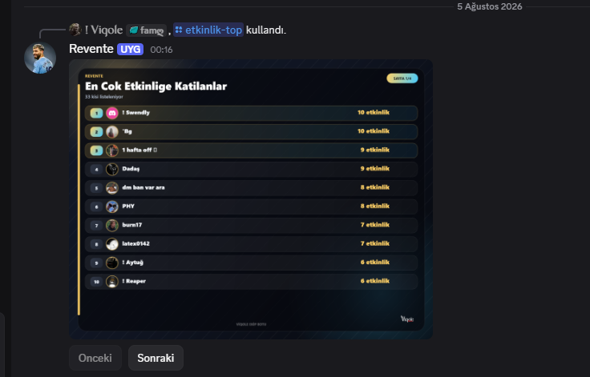

# 🎮 FiveM Ekip Yönetim Botu & Web Yönetim Paneli

<div align="center">


<p align="center">
  <strong>FiveM ekipleri, çeteleri ve toplulukları için geliştirilmiş; moderasyon, farm takibi, ticket sistemi, IC oyuncu denetimi, ses/etkinlik istatistikleri ve modern web yönetim paneline sahip hepsi bir arada Discord botu.</strong>
</p>

<p align="center">
  
</p>

</div>

---

## 📸 Ekran Görüntüleri ve Arayüz Galerisi

### 🌐 Web Yönetim Paneli
<table>
  <tr>
    <td width="50%" align="center">
      <b>📊 Web Paneli Ana Dashboard</b><br/><br/>
      
    </td>
    <td width="50%" align="center">
      <b>🚜 Web Panel - Farm Yönetim Sekmesi</b><br/><br/>
      
    </td>
  </tr>
  <tr>
    <td colspan="2" align="center">
      <b>🔑 Web Panel - Yetki & İzin Yönetimi Sekmesi</b><br/><br/>
      
    </td>
  </tr>
</table>

### 🚜 Farm Takip, Teslimat & Liderlik Sıralaması
<table>
  <tr>
    <td width="50%" align="center">
      <b>📦 Butonlu Farm Teslimat Paneli</b><br/><br/>
      
    </td>
    <td width="50%" align="center">
      <b>🏆 Farm Top 10 Sıralama Afişi (Canvas)</b><br/><br/>
      
    </td>
  </tr>
  <tr>
    <td colspan="2" align="center">
      <b>📝 Onay / Red Farm Yönetim Logları</b><br/><br/>
      
    </td>
  </tr>
</table>

### 🎫 Başvuru, Ticket & Otomatik DM Akışı
<table>
  <tr>
    <td width="50%" align="center">
      <b>🟢 Başvuru Paneli (Açık Durum)</b><br/><br/>
      
    </td>
    <td width="50%" align="center">
      <b>🔴 Başvuru Paneli (Kapalı Durum)</b><br/><br/>
      
    </td>
  </tr>
  <tr>
    <td colspan="2" align="center">
      <b>📨 Yeni Başvuru Bildirimi & Kanal Karşılama</b><br/><br/>
      
    </td>
  </tr>
  <tr>
    <td width="50%" align="center">
      <b>✅ Adaya Otomatik DM: Başvuru Onaylandı</b><br/><br/>
      
    </td>
    <td width="50%" align="center">
      <b>❌ Adaya Otomatik DM: Başvuru Reddedildi</b><br/><br/>
      
    </td>
  </tr>
</table>

### 🛡️ Moderasyon, Güvenlik & Loglama
<table>
  <tr>
    <td width="50%" align="center">
      <b>🔨 Ceza & Yasaklama Log Embedi</b><br/><br/>
      
    </td>
    <td width="50%" align="center">
      <b>📂 Otomatik Kurulan Log Kanalları Ağacı</b><br/><br/>
      
    </td>
  </tr>
  <tr>
    <td colspan="2" align="center">
      <b>⚡ Toplu Perm Çekme Slash Komutu Arayüzü</b><br/><br/>
      
    </td>
  </tr>
</table>

### 📊 Ekip İçi Denetim, Aktiflik & Profil İstatistikleri
<table>
  <tr>
    <td width="50%" align="center">
      <b>👤 Detaylı Kullanıcı Bilgi & Sicil Kartı</b><br/><br/>
      
    </td>
    <td width="50%" align="center">
      <b>🔍 Bio / Guild Etiketi Taşımayanlar Listesi</b><br/><br/>
      
    </td>
  </tr>
  <tr>
    <td colspan="2" align="center">
      <b>🎖️ En Çok Etkinliğe Katılanlar Sıralaması (Canvas)</b><br/><br/>
      
    </td>
  </tr>
</table>

### 📬 Ban Affı, InGame Duyuruları & Çekiliş
<table>
  <tr>
    <td width="33%" align="center">
      <b>🕊️ Ban Affı Başvuru Paneli</b><br/><br/>
      
    </td>
    <td width="33%" align="center">
      <b>🎮 InGame Etkinlik Duyurusu</b><br/><br/>
      
    </td>
    <td width="33%" align="center">
      <b>🎉 Otomatik Çekiliş Sonuç Kartı</b><br/><br/>
      
    </td>
  </tr>
</table>

---

## 🌟 Öne Çıkan Özellikler

- 🛡️ **Kapsamlı Moderasyon & Güvenlik:**
  - `/ban`, `/unban`, `/forceban` (ID ile sunucuda olmayanları kalıcı yasaklama).
  - 3 aşamalı otomatik uyarı sistemi (`/uyari`).
  - Dinamik yetki atama (`/perm`, `/topluperm-çek`).
  - Kanal kilit sistemi (`/kanal`) ve toplu mesaj silme (`/sil`).
  - Otomatik rol (`/oto-rol`) ve kullanıcı analizleri (`/kullanıcıbilgi`).

- 🎫 **Gelişmiş Ticket & Başvuru Sistemi:**
  - Birden fazla kategori (Destek, Ekip Başvurusu vb.) destekli butonlu panel.
  - Özel form modal pencereleri (Yaş, FiveM saati, Map bilgisi, POV video vb.).
  - Otomatik HTML Transcript kaydı ve harici transcript API entegrasyonu.
  - Tek komutla tüm açık talepleri kapatma (`/butunticketlerikapat`).

- 🚜 **Farm Takip & Teslimat Yönetimi:**
  - Butonlu Farm Bildirim Paneli (`/farm-panel`).
  - Yetkililer için onay ve red butonlu yönetim kanalı bildirimi.
  - Üye bazlı farm sorgulama (`/farm <üye>`), manuel ekleme/çıkarma (`/farmekle`, `/farmcikar`).
  - `@napi-rs/canvas` ile oluşturulan dinamik görsel Top 10 sıralama kartı (`/farm-top`).

- 🎮 **FiveM IC (In-Game) Sunucu Kontrolü:**
  - FiveM sunucu API'sine bağlanarak oyuncu listesini dinamik sorgulama.
  - Ekip üyelerinin sunucuda aktif olup olmadığını anlık tespit etme.
  - Canlı güncellenen durum mesajı ve otomatik kontrol döngüsü.

- 📊 **Ses & Mesaj Aktiflik Takibi:**
  - Ses kanallarındaki kalma süresi ve mesaj sayılarının SQLite üzerinde kayıt altına alınması.
  - Görsel haftalık ses liderlik tablosu (`/ses-top`).
  - Son 1 hafta içinde pasif kalan üyeleri tespit eden inaktiflik taraması (`/inaktif`).
  - Ekip üyelerinin durumlarında ekip adı/etiketi kontrolü (`/bio-guild`).

- 📬 **Panelli & Panelsiz Ban Affı Sistemi:**
  - Kullanıcıların hem panelli hem de belirli bir kanala yazarak (panelsiz) ban affı talep edebilmesi.
  - Yetkililere özel onay, red, silme ve arşive alma butonları.

- 🎥 **YouTube & İçerik Yönetimi:**
  - Ekip üyelerinin YouTube içerik durumları ve video başvurularını takip etme.
  - YouTube yönetim kanalı ve onay/red mekanizması.

- 🎉 **Etkinlik & Çekiliş Modülü:**
  - Zengin Container v2 kartlarıyla toplantı ve etkinlik duyuruları (`/etkinlik`).
  - Etkinliklere katılım sağlayanları görsel afişle sıralayan lider tablosu (`/etkinlik-top`).
  - Dahili çekiliş sistemi (`/çekiliş-başlat`, `/çekiliş-bitir`, `/çekiliş-yenidençek`).

- 🌐 **Modern Web Yönetim Paneli:**
  - Express.js tabanlı, Discord OAuth2 ile giriş sağlayan web arayüzü.
  - Dashboard, bot ayarları, rol & kanal konfigürasyonları, farm listesi ve veritabanı yönetimi.
  - Bot içerisinden `/ekipyonetim-panel` ile tek kullanımlık güvenli giriş bağlantısı oluşturma.

- 🎨 **Yüksek Çözünürlüklü Görsel Kartlar (Canvas):**
  - Sunucuya giriş, çıkış, ban ve kick durumlarında özelleştirilebilir şık kart tasarımları.

---

## 📁 Proje Dizin Yapısı

```text
EkipBotu/
├── commands/             # Discord Slash (/) komut dosyaları (44 adet)
├── handlers/             # Ticket, Ban Affı, YouTube ve Çekiliş olay işleyicileri
├── services/             # Harici servisler (YouTube API vb.)
├── tasks/                # Arka plan periyodik cron görevleri (Ses, IC kontrol vb.)
├── utils/                # Yardımcı fonksiyonlar (Canvas, Emojiler, İstatistikler, Config)
├── web/                  # Express Web Yönetim Paneli (Public dosyaları ve API rotaları)
├── Resimler/             # Bot ve Web Panel ekran görüntüleri (Açık kaynak arayüz galerisi)
├── .env.example          # Ortam değişkenleri örnek şablonu
├── config.example.json   # Detaylı bot ve kanal yapılandırma şablonu
├── db.js                 # better-sqlite3 merkezi veritabanı motoru
├── ecosystem.config.cjs  # PM2 7/24 çalıştırma konfigürasyonu
├── index.js              # Botun ana giriş ve başlatma noktası
├── package.json          # Node.js paket tanımları ve bağımlılıklar
└── registerCommands.js   # Slash komutlarını Discord API'ye kaydedici
```

---

## 🚀 Hızlı Başlangıç & Kurulum

### 1. Gereksinimler
- **Node.js:** `v18.0.0` veya üzeri (Önerilen: v20 LTS)
- **Discord Bot Token & Application ID:** [Discord Developer Portal](https://discord.com/developers/applications)

### 2. Projeyi İndirin ve Bağımlılıkları Yükleyin

```bash
# Proje dizinine geçin
cd EkipBotu

# Bağımlılıkları yükleyin
npm install
```

### 3. Yapılandırma Dosyalarını Hazırlayın

Projede iki şekilde yapılandırma yapabilirsiniz:
1. **`.env` Dosyası ile (Temel Kimlik Bilgileri):**
   `.env.example` dosyasını kopyalayarak `.env` yapın ve bot bilgilerinizi girin:

   ```bash
   cp .env.example .env
   ```

   `.env` dosyasını bir metin editörüyle açarak bot kimlik bilgilerinizi doldurun:
   ```env
   TOKEN=OTYx...Bot_Tokeniniz...
   CLIENT_ID=123456789012345678
   GUILD_ID=987654321098765432
   WEB_PORT=3000
   ```

2. **`config.json` Dosyası (Ekip İsmi, Kanallar, Roller ve Görseller):**
   Botun ekip ismi (`ekipIsmi`), logo & banner yolları (`logoPath`, `bannerPath`), kurucu ID'leri (`ownerIds`) ve tüm kanal/rol ayarları **`config.json`** dosyasında saklanır. 
   - Bot ilk başlatıldığında `config.json` yoksa otomatik olarak [`config.example.json`](file:///c:/Users/Berk/Desktop/EkipBotu/config.example.json) şablonundan oluşturulur.
   - Bu ayarları doğrudan dosyadan düzenleyebileceğiniz gibi, bot açıldıktan sonra Discord içinden **`/ekipsistem`** sihirbazıyla veya **Web Yönetim Paneli** üzerinden tek tıkla da yapılandırabilirsiniz.

### 4. Slash Komutlarını Discord'a Kaydedin

Botu sunucunuza ilk kez eklediğinizde veya yeni komut eklediğinizde çalıştırın:

```bash
npm run register
```

### 5. Botu Başlatın

```bash
npm start
# veya
node index.js
```

---

## 🔄 PM2 ile 7/24 Kesintisiz Çalıştırma (Sunucu / VDS)

Botun sunucunuzda arka planda sürekli açık kalması ve sistem yeniden başlasa dahi otomatik ayağa kalkması için PM2 kullanabilirsiniz:

```bash
# PM2'yi global kurun (eğer kurulu değilse)
npm install -g pm2

# Botu PM2 ile başlatın
pm2 start ecosystem.config.cjs

# Logları canlı takip edin
pm2 logs ekip-botu

# Sisteme başlangıç servisi olarak kaydedin
pm2 save
pm2 startup
```

---

## 🛠️ Sihirbaz ile Otomatik Kurulum (`/ekipsistem`)

Botunuz sunucuya katıldıktan ve `npm run register` yapıldıktan sonra:
1. Sunucunuzda bot yetkilisinin görebileceği bir kanalda **`/ekipsistem`** komutunu çalıştırın.
2. Açılan panelden **Otomatik Kurulum Sihirbazı**'nı seçin.
3. Bot sunucunuzda gerekli tüm kategorileri (Yönetim, Loglar, Başvuru vb.), log kanallarını ve rolleri otomatik olarak oluşturacak ve `config.json` dosyasını anında güncelleyecektir!

---

## 📋 Slash (/) Komut Listesi (44 Adet)

### 🛡️ Moderasyon & Yönetim
| Komut | Açıklama |
|---|---|
| `/ban <üye> <sebep>` | Belirtilen kullanıcıyı sunucudan yasaklar. |
| `/unban <kullanıcı_id> <sebep>` | Yasaklanan bir üyenin banını kaldırır. |
| `/forceban <id> <sebep>` | Sunucuda bulunmayan bir kullanıcıyı ID ile kalıcı olarak yasaklar. |
| `/uyari <üye> <sebep>` | Üyeye uyarı ekler (3 uyarıda otomatik ban). |
| `/sil <miktar>` | Belirtilen kanaldaki mesajları toplu temizler. |
| `/kanal <islem> <hedef-kanal>` | Kanalı kilitler veya kilidini açar. |
| `/perm <kisi/rol> <yetki>` | Dinamik yetkili listesini düzenler. |
| `/topluperm-çek <kriter>` | Yetkileri kriterlere göre topluca geri çeker. |
| `/oto-rol <rol>` | Sunucuya yeni girenlere otomatik verilecek rolü ayarlar. |

### 📊 Ekip & Aktiflik Yönetimi
| Komut | Açıklama |
|---|---|
| `/ekipsistem` | Ekip yönetim sistemi kurulum ve denetim panelini açar. |
| `/ekipyonetim-panel` | Web Paneline giriş için tek kullanımlık güvenli bağlantı üretir. |
| `/aktiflik <rol>` | Belirli bir rol için anlık aktiflik kontrolü başlatır. |
| `/ekipickontrol` | FiveM IC sunucu kontrol ayarlarını ve döngüsünü düzenler. |
| `/inaktif <tür>` | Son 1 haftada ses, mesaj veya etkinlikte pasif üyeleri listeler. |
| `/inaktif-göster <tür>` | İnaktiflik listesini detaylı sayfa yapısıyla ekrana getirir. |
| `/ses-top` | Haftalık ses aktiflik sıralamasını görsel Canvas kartıyla gösterir. |
| `/kullanıcıbilgi <üye>` | Üyenin tüm ses, mesaj, farm ve kayıt istatistiklerini raporlar. |
| `/bio-guild` | Üyelerin Discord durumlarında ekip etiketini tarar. |
| `/tik-kontrol <mesaj_id> <rol>` | Belirtilen duyuru mesajında hangi üyelerin tepki (tik) verip vermediğini raporlar. |

### 🚜 Farm Sistemi
| Komut | Açıklama |
|---|---|
| `/farm-panel` | Üyelerin farm teslimatı yapabileceği butonlu teslim paneli gönderir. |
| `/farm <üye>` | Bir üyenin toplam teslim ettiği farm miktarını gösterir. |
| `/farm-top` | Top 10 farm sıralamasını görsel grafik afişiyle sunar. |
| `/farmekle <üye> <miktar>` | Üyenin farm hesabına teslimat ekler. |
| `/farmcikar <üye> <miktar>` | Üyenin farm hesabından miktar düşer. |

### 🎫 Destek & Başvuru (Ticket)
| Komut | Açıklama |
|---|---|
| `/ticket-panel` | Başvuru ve Destek açma butonlarının yer aldığı paneli gönderir. |
| `/ticket-ekle <kullanıcı>` | Açık olan ticket kanalına bir kullanıcıyı dahil eder. |
| `/ticket-çıkar <kullanıcı>` | Ticket kanalından belirtilen kullanıcıyı çıkarır. |
| `/basvuru-durum` | Başvuru sistemini geçici olarak kapatır veya açar. |
| `/butunticketlerikapat` | Açık olan tüm destek kanallarını topluca kapatıp arşivler. |

### 📬 Ban Affı Sistemi
| Komut | Açıklama |
|---|---|
| `/banaf-panel` | Kullanıcıların ban affı talebi oluşturabileceği butonlu başvuru panelini kurar. |
| `/panelsizbanaf-sistemi` | Belirli kanala mesaj atarak başvuru yapılan panelsiz ban affı sistemini açar/kapatır. |
| `/acilan-banlar` | Açılan ve onaylanan ban affı taleplerini listeler. |

### 🎤 Ses & Bot Ses Yönetimi
| Komut | Açıklama |
|---|---|
| `/ses-yönet topla <hedef>` | Üyeleri bulunduğunuz ses kanalına topluca çeker. |
| `/ses-yönet taşı <kaynak> <hedef>` | Belirtilen kanaldaki herkesi diğer kanala aktarır. |
| `/ses-yönet mute` | Odadaki üyeleri topluca susturur veya susturmasını açar. |
| `/botses gir <kanal>` | Botun seçilen ses kanalında 7/24 kalmasını sağlar. |
| `/botses çık` | Botun bulunduğu ses kanalından ayrılmasını sağlar. |
| `/botses durum` | Botun ses kanalı bağlantı durumunu raporlar. |

### 🎉 Etkinlik & Çekiliş
| Komut | Açıklama |
|---|---|
| `/ingame` | FiveM InGame etkinliği duyurusu ve katılım formu oluşturur. |
| `/etkinlik-top` | En çok etkinliğe katılan üyeleri görsel sıralamayla listeler. |
| `/cekilis-baslat` | Otomatik zamanlayıcılı yeni çekiliş başlatır. |
| `/cekilis-bitir <mesaj_id>` | Devam eden bir çekilişi erken sonlandırır. |
| `/cekilis-yenidencek <mesaj_id>` | Tamamlanmış bir çekiliş için talihliyi yeniden belirler. |

### ⚙️ İletişim, Kayıt & Veri Yönetimi
| Komut | Açıklama |
|---|---|
| `/dm-duyuru <rol> <mesaj>` | Seçilen roldeki tüm üyelere özelden (DM) toplu duyuru mesajı gönderir. |
| `/youtube-sistem` | YouTube içerik takip ve başvuru sistemi panelini kurar. |
| `/kill` | Yeni bir kill POV paylaşım ve kayıt kanalı oluşturur. |
| `/dosya <no/id>` | Belirtilen dosya numarasına veya Discord ID'sine ait detaylı ceza/veri kaydını gösterir. |
| `/data-sıfırla` | Seçilen veya tüm bot veritabanı kayıtlarını güvenli şekilde sıfırlar. |

---

## 🌐 Web Yönetim Paneli

Bot ile birlikte gelen yerleşik web paneli sayesinde tüm bot fonksiyonlarını tarayıcınızdan yönetebilirsiniz:

1. `.env` veya `config.json` dosyasında `WEB_PORT` (Varsayılan: `3000`) ve `PANEL_URL` değerlerini belirleyin.
2. Discord Developer Portal > **OAuth2** sekmesinden Redirect URL olarak `http://localhost:3000/auth/callback` (veya kendi alan adınızı) ekleyin.
3. Bot açıkken tarayıcınızdan `http://localhost:3000` adresine gidin veya Discord içinden `/ekipyonetim-panel` yazarak tek kullanımlık giriş linki alın.

---

## 📄 Lisans

Bu proje **MIT Lisansı** altında lisanslanmıştır. Dilediğiniz gibi geliştirebilir, değiştirebilir ve açık kaynak topluluklarında paylaşabilirsiniz.
